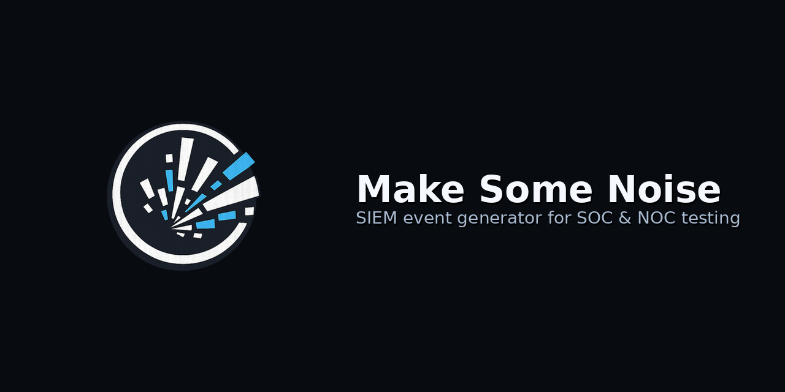

# Make Some Noise

<p align="center">
  
</p>

<p align="center">
  <a href="https://github.com/TheLawsOfChaos/make-some-noise/actions">
    
  </a>
  <a href="https://github.com/TheLawsOfChaos/make-some-noise/blob/main/LICENSE">
    
  </a>
  <a href="https://github.com/TheLawsOfChaos/make-some-noise/releases">
    
  </a>
  
</p>

<p align="center">
  <a href="https://hub.docker.com/r/thelawsofchaos/makesomenoise-frontend">
    
  </a><br />
  <a href="https://hub.docker.com/r/thelawsofchaos/makesomenoise-backend">
    
  </a><br />
  <br />
</p>

A web application and API for generating synthetic security log events and metrics to feed Splunk Enterprise Security, Splunk ITSI and Cribl for SIEM and SOAR content development and testing.

## Features

- **27 event sources**: Windows, endpoint, identity, cloud, network, web, infrastructure and metrics; 179 templates in all (list below)
- **Three delivery methods**: Syslog (UDP or TCP, RFC 3164 or RFC 5424), Splunk HTTP Event Collector, or files
- **Per-source routing**: each source can go to its own destination, so one run can feed several indexes
- **Preview before sending**: see a generated event, or generate a counted batch
- **Continuous generation**: a background run at a global rate with per-source weights
- **Headless API**: everything the UI does is a REST call, so Ansible or CI pipelines can drive the backend alone
- **Docker**: two images, backend and UI, run together with Docker Compose

## Quick Start

### Using Docker Compose

```bash
cd make-some-noise

# The backend runs as uid 1000 and writes to these two bind mounts
mkdir -p config output
sudo chown -R 1000:1000 config output   # or set "user:" in docker-compose.yml to your own uid

# Optional: require a token on the API (the UI attaches it for you)
export API_TOKEN=$(openssl rand -hex 24)

docker compose up -d --build

open http://localhost:3000          # web UI
curl http://localhost:8081/api/health   # API (add -H "Authorization: Bearer $API_TOKEN" when set)
```

Both ports are bound to 127.0.0.1 in `docker-compose.yml`. To expose them to a network, set `API_TOKEN` first and change the port bindings.

`docker-compose.release.yml` runs the published images from Docker Hub instead of building; it is pinned to a version, not `latest`.

Rootless Podman: the bind mounts need the `:U` option (`./config:/config:U`) or `--userns=keep-id` so uid 1000 inside the container can write them.

### What happens on first start

- The backend creates one destination, `default-file`, writing to `/tmp/output/siem-events.log` inside the container (`./output/siem-events.log` on the host).
- Nothing is generating. Start a run from the Noise Generator page or with `POST /api/noise/start`.
- Destinations persist in `./config/destinations.json`. The noise run does not persist: after a restart it must be started again (see Known limitations).

### Manual Development Setup

**Backend (Go 1.26):**
```bash
cd backend
go mod download
CONFIG_DIR=./config OUTPUT_DIR=./output go run .
# API on http://localhost:8080
```

**Frontend (Node 22):**
```bash
cd frontend
npm ci
npm run dev
# UI on http://localhost:3000, proxying /api to localhost:8080
```

## Supported Event Sources

Source ids are what the API takes in `event_type` and `event_type_id`. Templates are listed by their ids (`event_id` in `/api/generate`, `template_ids` in `/api/noise/start`). `GET /api/event-sources` returns this catalogue with descriptions.

### Windows
- **Windows Security** (`windows_security`), XML, sourcetype `XmlWinEventLog:Security`: 4624, 4625, 4672, 4688, 4720
- **Windows Sysmon** (`windows_sysmon`), XML, sourcetype `XmlWinEventLog:Microsoft-Windows-Sysmon/Operational`: 1, 3, 7, 8, 10, 11, 22

### Endpoint
- **CrowdStrike Falcon** (`crowdstrike`), JSON: DetectionSummaryEvent, ProcessRollup2, NetworkConnectIP4, DnsRequest, FileWritten, UserLogon
- **Linux Auditbeat** (`linux_auditbeat`), ECS JSON: process, file, user_login, socket, package
- **Microsoft Defender for Endpoint** (`microsoft_defender`), JSON: AlertEvidence, DeviceEvents, DeviceProcessEvents, DeviceNetworkEvents, DeviceFileEvents

### Identity
- **Microsoft Active Directory** (`microsoft_ad`), XML: 4720, 4722, 4723, 4724, 4725, 4726, 4728, 4729, 4732, 4740, 4767
- **Okta System Log** (`okta`), JSON: user.session.start, user.authentication.sso, user.mfa.factor.activate, user.account.lock, user.account.reset_password
- **Azure AD Sign-in** (`azure_ad_signin`), JSON: SignInSuccess, SignInFailure, MFAChallenge, ConditionalAccessBlock

### Cloud
- **AWS CloudTrail** (`aws_cloudtrail`), JSON: ConsoleLogin, AssumeRole, CreateUser, DeleteUser, PutBucketPolicy, AuthorizeSecurityGroupIngress, RunInstances, StopInstances, CreateAccessKey, GetSecretValue
- **AWS GuardDuty** (`aws_guardduty`), JSON: six finding types
- **AWS VPC Flow Logs** (`aws_vpcflow`), text: ACCEPT, REJECT
- **Azure Activity Logs** (`azure_activity`), JSON: Write, Delete, Action operations
- **Office 365 Audit** (`o365_audit`), JSON: FileAccessed, FileModified, FileDeleted, UserLoggedIn, MailItemsAccessed, TeamCreated
- **Kubernetes Audit** (`kubernetes_audit`), JSON: create, get, update, delete, exec

### Network
- **Cisco ASA** (`cisco_asa`), syslog text: 106001, 106006, 106023, 111008, 113039, 302013, 302014, 302015
- **Cisco Firepower** (`cisco_firepower`), JSON: intrusion, connection, file, malware
- **Palo Alto Firewall** (`paloalto`), CSV, sourcetypes `pan:traffic`, `pan:threat`, `pan:url`: TRAFFIC, THREAT, URL (simplified field layout, see Known limitations)
- **Suricata** (`suricata`), EVE JSON: alert, flow, dns, http, tls, fileinfo
- **Zeek** (`zeek`), JSON: conn, dns, http, ssl, files, notice
- **DNS Query Logs** (`dns_query`), text: QUERY, RESPONSE, NXDOMAIN, BLOCKED

### Web
- **Apache/Nginx Access Logs** (`webserver`), combined log format: 200, 302, 401, 403, 404, 500
- **AWS ALB Access Logs** (`aws_alb`), text: http, https, wss

### Infrastructure
- **VMware vCenter** (`vmware_vcenter`), JSON: VmCreatedEvent, VmPoweredOnEvent, VmPoweredOffEvent, VmMigratedEvent, AlarmStatusChangedEvent, UserLoginSessionEvent

### Metrics (sourcetype `metrics`)
- **System** (`metrics_system`): cpu, memory, disk_space, disk_io, network, load, temperature
- **Application** (`metrics_application`): response_time, request_rate, error_rate, queue, threads, connections, jvm
- **Database** (`metrics_database`): query_performance, connections, buffer_pool, transactions, replication, locks, tablespace
- **Web/API** (`metrics_webapi`): http_status, latency, throughput, bandwidth, ssl, upstream, cache

The metrics sources produce a JSON document shaped like a HEC metrics payload, but it is delivered as the body of an ordinary event (`/services/collector/event`), so Splunk indexes it as a JSON event, not as a metric. Sending to a metrics index through `/services/collector` is a follow-up.

## Delivery Methods

### Syslog (UDP or TCP)
- RFC 3164 (BSD) or RFC 5424 framing, one message per event
- Hostname is the event's host; app-name is `siem-event-generator`
- `facility` (0 to 23, default 1) and `severity` (0 to 7, default 6); 0 is a valid value
- TCP reconnects on the next send after a failed write
- Plain text only; there is no TLS syslog

### Splunk HEC
- Batched: `batch_size` events per POST (default 100), or whatever is buffered after one second
- A failed batch is kept and retried with exponential backoff (1 s to 30 s). The buffer holds ten batches; past that the oldest events are dropped and counted in `total_dropped`
- TLS certificate verification is on; set `insecure_skip_verify: true` for a self-signed collector
- Redirects are refused, so the token only ever goes to the configured URL
- `index`, `source` and `sourcetype` on the destination apply to every event sent through it; without `sourcetype` each template's own sourcetype is used

### File
- One event per line, appended to a file under the output directory (`OUTPUT_DIR`, `/tmp/output` in the container). Paths outside it are refused
- Rotation when `max_size_mb` is set (the default destination uses 100), keeping `rotate_keep` files (default 5)

## API

All routes are under `/api`. When `API_TOKEN` is set, every route except `/api/health` requires `Authorization: Bearer <token>`.

| Method and path | What it does |
|---|---|
| `GET /api/health` | status, version, uptime |
| `GET /api/event-types` | the sources |
| `GET /api/event-types/:type/schema` | one source with its templates |
| `GET /api/event-sources` | sources grouped by category, with templates (what the Noise Generator page uses) |
| `POST /api/generate/preview` | one event: `{"event_type":"zeek","event_id":"conn"}` |
| `POST /api/generate` | a batch, optionally sent: `{"event_type":"zeek","event_id":"conn","count":100,"destination_id":"<id>","rate_per_second":10,"overrides":{...}}` (`count` 1 to 10000; `rate_per_second` paces the sends) |
| `GET /api/destinations` | list (HEC tokens are masked) |
| `GET /api/destinations/:id` | one destination |
| `POST /api/destinations` | create; body below |
| `PUT /api/destinations/:id` | replace; send the token mask `********` (or omit the token) to keep the stored token |
| `DELETE /api/destinations/:id` | delete |
| `POST /api/destinations/:id/test` | test a saved destination |
| `POST /api/destinations/test` | test an unsaved `{"type":..., "config":{...}}` |
| `GET /api/templates`, `GET /api/templates/:id`, `POST /api/templates`, `PUT /api/templates/:id`, `DELETE /api/templates/:id` | custom template store (stored and listed, not yet used by generation; see Known limitations) |
| `POST /api/noise/start` | start the continuous run; body below |
| `POST /api/noise/stop` | stop it |
| `GET /api/noise/status` | running, config, `skipped_sources` (enabled sources that generate nothing, with the reason), stats |
| `PUT /api/noise/config` | change `rate_per_second` or `enabled_sources` of a running generation (destinations must already be part of the run) |
| `GET /api/noise/stats` | the stats alone |

### Starting a run

```json
POST /api/noise/start
{
  "destination_id": "<fallback destination id>",
  "rate_per_second": 50,
  "enabled_sources": [
    {"event_type_id": "windows_security", "enabled": true, "weight": 30},
    {"event_type_id": "zeek", "enabled": true, "weight": 20, "template_ids": ["conn", "dns"]},
    {"event_type_id": "paloalto", "enabled": true, "weight": 10, "destination_id": "<another destination id>"}
  ]
}
```

- `rate_per_second` (0.1 to 10000) is the total rate for the whole run.
- `weight` (1 to 100, default 10) is relative. A source's weight is divided across its selected templates, so a source with many templates gets less per template than one with few; set `template_ids` to narrow a source.
- `destination_id` per source overrides the fallback. Every destination used must be in the start request; one added later through `PUT /api/noise/config` is reported in `skipped_sources`.
- The stats report `total_generated`, `total_sent`, `total_errors` (send errors, with the last five in `error_samples`), `total_dropped` (HEC buffer overflow) and per-type and per-template counts.

### Destination bodies

**Syslog:**
```json
{
  "name": "lab syslog",
  "type": "syslog_udp",
  "config": {"host": "192.168.1.100", "port": 514, "facility": 1, "severity": 6, "format": "rfc3164"}
}
```
`type` is `syslog_udp` or `syslog_tcp`; `format` is `rfc3164` (default) or `rfc5424`.

**Splunk HEC:**
```json
{
  "name": "lab splunk",
  "type": "hec",
  "config": {
    "url": "https://splunk:8088/services/collector/event",
    "token": "your-hec-token",
    "index": "main",
    "batch_size": 100,
    "insecure_skip_verify": false
  }
}
```
Optional `source` and `sourcetype` override those of every event sent through the destination.

**File:**
```json
{
  "name": "local file",
  "type": "file",
  "config": {"file_path": "/tmp/output/events.log", "max_size_mb": 100, "rotate_keep": 5}
}
```

## Configuration

### Environment variables (backend)

| Variable | Default | Meaning |
|---|---|---|
| `PORT` | `8080` | listen port |
| `CONFIG_DIR` | `/config` | where `destinations.json` and `templates.json` are kept (written 0600) |
| `OUTPUT_DIR` | `/tmp/output` | the only directory file destinations may write under |
| `API_TOKEN` | unset | when set, required as a bearer token on every `/api` route except `/api/health` |
| `GIN_MODE` | `release` | set `debug` for request-level logging from the framework |

The frontend container takes `API_TOKEN` too and attaches it to the proxied `/api` calls, so the browser never holds it. Anyone who can open the UI can therefore use the API; keep the UI port on a trusted network.

### Pre-seeding destinations

Put a `destinations.json` in `./config` before the first start to skip the UI:

```json
[
  {"id": "splunk", "name": "lab splunk", "type": "hec",
   "config": {"url": "https://splunk:8088/services/collector/event", "token": "your-hec-token", "index": "noise"}}
]
```

The file holds the token in clear text; it is written 0600 and the API never returns it, but treat the directory as a secret.

### Upgrading from 1.0.x

- `verify_ssl` is gone. Verification is now on by default. A HEC destination to a self-signed collector that worked before needs `insecure_skip_verify: true` (the "Skip TLS certificate verification" box in the UI), otherwise sends fail with a certificate error.
- The API returns `********` in place of HEC tokens. Clients that read a destination and PUT it back unchanged keep working.
- Container ports are bound to 127.0.0.1 and the backend runs as uid 1000; see Quick Start for the bind mount ownership.
- Events are single-line. A props configuration that expected pretty-printed JSON or XML needs its line breaking reset.

## Known limitations

- The noise run lives in memory only: after a container restart it must be started again with `POST /api/noise/start`. A start-on-boot profile is a planned follow-up.
- One global rate with relative weights; there is no per-source rate.
- Hosts, users, IPs and accounts are random per event, so there is no stable population across events.
- Several templates describe alerts rather than background activity (detections, GuardDuty findings, Sysmon 8 and 10); choose `template_ids` to keep a background run quiet.
- The custom template API stores templates but generation does not use them, and the JSON files under `templates/` are examples only.
- Palo Alto events use a simplified field layout, not the full PAN-OS CSV.
- The destination test for a HEC destination posts to the token's default index, so it does not prove the configured `index` is allowed.

## Use Cases

- **SIEM Content Development**: Generate realistic events to test detection rules and correlation searches
- **Splunk ES Testing**: Validate Enterprise Security content packs and notable events
- **ITSI Service Monitoring**: Create metrics to test KPIs, glass tables, and service health scores
- **Training and Demos**: Generate sample data for security training environments
- **Load Testing**: Stress test log ingestion pipelines with high-volume event generation
- **Parser Development**: Test Splunk props/transforms or Cribl pipelines with known event formats

## License

Apache License 2.0. See [LICENSE](LICENSE).
